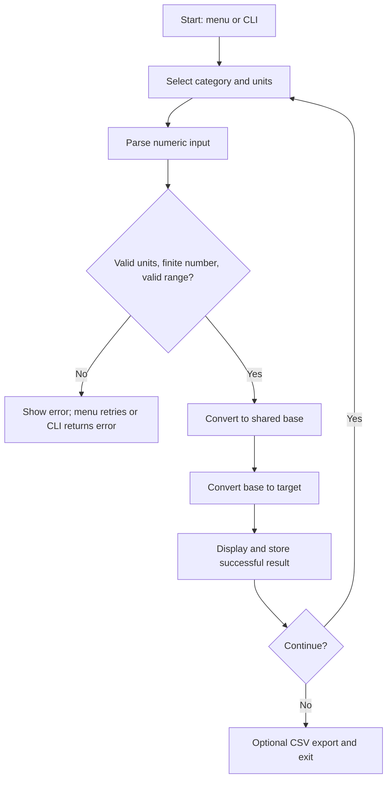

# Presentation and demo guide

1. Title (30 seconds): Unit Converter; add name(s), group, class, subject code.
2. Goal and requirements (45 seconds): reliable offline conversions; Python 3.10+,
   terminal, no external packages; GitHub for sharing and contribution tracking.
3. Introduction (45 seconds): explain your own motivation. Compare a manual table
   lookup with shared-base conversion, validation, and batch processing.
4. Flow (60 seconds): explain the flow below and separate engine from interface.
5. Implementation (90 seconds): show data classes, dictionaries, tuples, lists,
   sets, loop dispatch, functions, custom exception, and temperature offsets.
6. Live demo (3 minutes): use the cases below; record the session and take screenshots.
7. Results and discussion (60 seconds): show tests, actual outputs, float limits,
   validation policy, and one challenge (temperature conversion needs an offset).
8. Conclusion and future work (45 seconds): explain lessons in your own words;
   possible extensions include a GUI, persistent history, and Decimal arithmetic.
9. References and verified public GitHub URL (30 seconds).

## Demonstration cases and expected observations

| Case | Input | Expected |
| --- | --- | --- |
| Length | convert length 1 mi km | 1.609344 km |
| Temperature offset | convert temperature 32 F C | 0 C |
| Temperature boundary | convert temperature -273.15 C K | 0 K |
| Invalid temperature | convert temperature -1 K C | Absolute-zero error |
| Decimal/binary data | convert data 1 KiB B | 1024 B |
| Invalid number | convert length abc m ft | Numeric-input error |
| Invalid target | convert length 1 m kg | Unknown length unit |
| Negative input | convert mass -1 kg lb | Nonnegative-quantity error |
| Overflow | convert length 1e308 km mm | Range error |
| Nonfinite | convert length nan m ft | NaN/infinity error |
| Batch | batch example_batch.csv batch_results.csv | 3 success, 2 rejected |
| Menu recovery | enter invalid menu selection, then 1 | Message then normal menu |
| Menu features | options 2 through 9 | All units, formulas, search, history, CSV, precision, clear |
| Cancellation | enter q at an action prompt | Action cancelled, menu returns |
| Exit | option 0 | Clean exit |

Run each command after `python unit_converter.py`. Batch rejection exit code 1 is
intentional. Capture the terminal showing your command and its actual output.
There are infinitely many possible numbers; demonstrate these input classes and the
all-pairs automated test instead of claiming exhaustive input coverage.

## Q&A practice

- Why use a base unit? One scale/offset pair per unit replaces many pairwise formulas.
- Why is temperature special? It includes an additive offset and absolute-zero limit.
- How do invalid inputs behave? A custom exception becomes an understandable message.
- How are results tested? Independent known values and all-pairs round trips, plus CSV
  and interface checks. Round trips alone cannot prove conversion factors are correct.
- How is history stored? A list of immutable records; export it before exiting.
- What can improve? Persistent storage, better large-file streaming, and a graphical UI.

Use your own experience for reflection; do not claim this guide is a recording or that
screenshots have already been captured.
